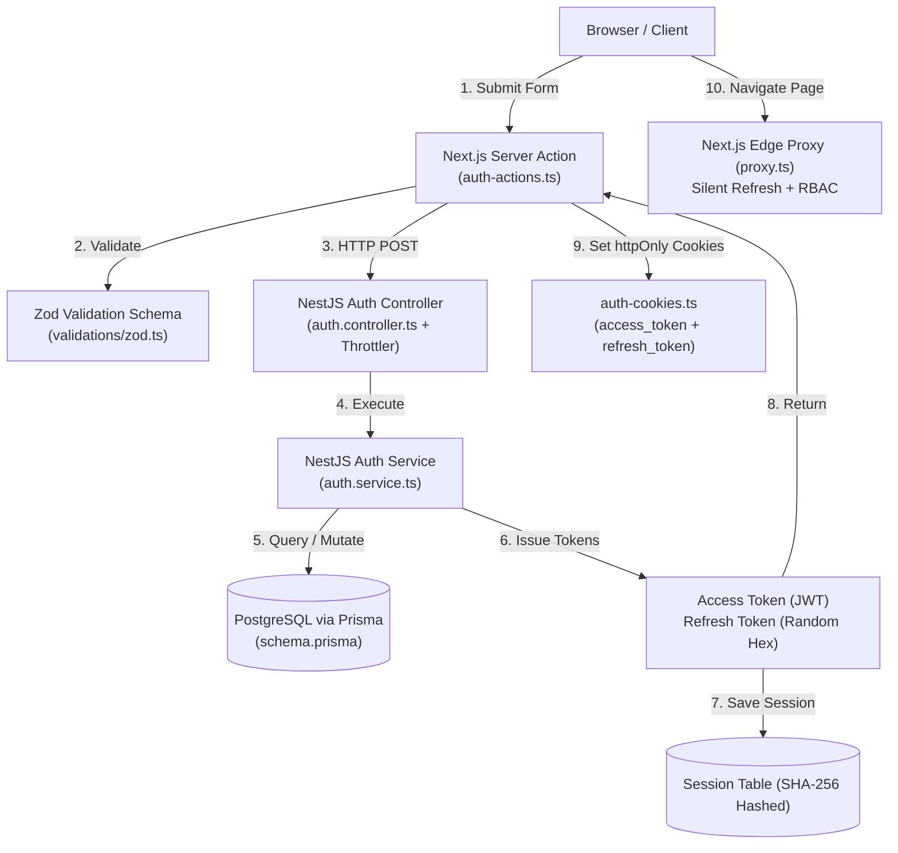

# 🔐 NeuroMeet — Authentication System Reverse-Engineering Guide

> **Purpose**: A step-by-step master guide to reverse-engineer and deeply understand the full-stack Authentication & Authorization system in NeuroMeet.
> **Architecture Pattern**: Next.js 15+ (App Router, Edge Middleware, Server Actions) + NestJS (Fastify, Throttler, Prisma, Bun Bcrypt).

---

## 🧭 High-Level Architecture Overview

The authentication system in **NeuroMeet** is built like an enterprise-grade production platform:
1. **Frontend**: Next.js Server Actions with Zod validation + HTTP-Only secure cookies + Edge proxy middleware (`jose`).
2. **Backend**: NestJS Fastify with `@nestjs/throttler` rate limiting + Bun native bcrypt + Dual-token rotation + SHA-256 hashed sessions.
3. **Database**: PostgreSQL via Prisma ORM (`User` and `Session` models).

---

## 🏛️ The 4 Pillars of NeuroMeet Auth

| Pillar | Focus | Key Files |
|---|---|---|
| **Pillar 1: Security Model & Data** | Database schemas, password hashing, lockout logic | [schema.prisma](file:///d:/Nile%20Unvirsity%20tasks/GRAD_PROJECT_NU/NeuroMeet/backend/prisma/schema.prisma), [auth.service.ts](file:///d:/Nile%20Unvirsity%20tasks/GRAD_PROJECT_NU/NeuroMeet/backend/src/auth/auth.service.ts) |
| **Pillar 2: Registration & OTP Lifecycle** | Sign-up, bcrypt-hashed OTP, email delivery, activation | [sign-up.tsx](file:///d:/Nile%20Unvirsity%20tasks/GRAD_PROJECT_NU/NeuroMeet/frontend/src/app/(auth)/sign-up/sign-up.tsx), [auth-actions.ts](file:///d:/Nile%20Unvirsity%20tasks/GRAD_PROJECT_NU/NeuroMeet/frontend/src/features/auth/actions/auth-actions.ts) |
| **Pillar 3: Dual Tokens & Silent Refresh** | Short-lived JWTs, long-lived refresh tokens, Edge auto-refresh | [proxy.ts](file:///d:/Nile%20Unvirsity%20tasks/GRAD_PROJECT_NU/NeuroMeet/frontend/src/proxy.ts), [auth-cookies.ts](file:///d:/Nile%20Unvirsity%20tasks/GRAD_PROJECT_NU/NeuroMeet/frontend/src/lib/auth-cookies.ts) |
| **Pillar 4: Route Protection & RBAC** | Role enforcement (`INSTRUCTOR`, `STUDENT`, `ADMIN`) | [auth.guard.ts](file:///d:/Nile%20Unvirsity%20tasks/GRAD_PROJECT_NU/NeuroMeet/backend/src/common/guards/auth.guard.ts), [current-user.decorator.ts](file:///d:/Nile%20Unvirsity%20tasks/GRAD_PROJECT_NU/NeuroMeet/backend/src/common/decorators/current-user.decorator.ts) |

---

## ⛓️ The 7-Link Learning Chain

Follow this exact sequence. Each step teaches you the prerequisite knowledge required for the next step.

---

### 🔗 Link 1: The Database Foundation (The Data Model)
* **File to open**: [backend/prisma/schema.prisma](file:///d:/Nile%20Unvirsity%20tasks/GRAD_PROJECT_NU/NeuroMeet/backend/prisma/schema.prisma#L74-L120)
* **Lines to inspect**: Lines 74–120 (`model User` and `model Session`)
* **What you learn**:
  1. `User` holds credentials and authentication state:
     - `password`: Hashed string (bcrypt).
     - `role`: Enum (`INSTRUCTOR`, `STUDENT`, `ADMIN`).
     - `failedLoginAttempts`: Counter for brute-force tracking.
     - `lockedUntil`: Timestamp locking account for 15 mins after 5 failed attempts.
     - `verificationCode`: Hashed 6-digit OTP.
     - `otpPurpose`: Enum (`SIGN_UP`, `RESET_PASSWORD`).
     - `otpExpire`: Date object representing expiration timestamp.
  2. `Session` handles multi-device logins:
     - `refreshToken`: SHA-256 hash of the refresh token.
     - `expiresAt`: Expiry date (7 days).
     - `userId`: Foreign key with `onDelete: Cascade`.
* **Ripple Effect on Link 2**: You now know what data shapes and constraints exist, so you understand why validation schemas check what they check.

---

### 🔗 Link 2: The Validation Contract (Zod & DTOs)
* **Files to open**:
  - Frontend: [frontend/src/validations/zod.ts](file:///d:/Nile%20Unvirsity%20tasks/GRAD_PROJECT_NU/NeuroMeet/frontend/src/validations/zod.ts)
  - Backend: [backend/src/auth/dto/auth-dto.ts](file:///d:/Nile%20Unvirsity%20tasks/GRAD_PROJECT_NU/NeuroMeet/backend/src/auth/dto/auth-dto.ts)
* **What you learn**:
  1. **Frontend (Zod)**: Performs client/action validation (`loginFormSchema`, `SignUpFormSchema`). Prevents bad requests from ever leaving the browser.
  2. **Backend (`class-validator`)**: Validates the payload independently using decorators (`@IsEmail()`, `@IsNotEmpty()`, `@MinLength(8)`). This ensures attackers using curl/Postman cannot bypass rules.
* **Ripple Effect on Link 3**: The UI forms and Server Actions directly feed form data into these validation functions.

---

### 🔗 Link 3: The User Trigger (Forms & Next.js Server Actions)
* **Files to open**:
  - UI Component: [frontend/src/app/(auth)/sign-up/sign-up.tsx](file:///d:/Nile%20Unvirsity%20tasks/GRAD_PROJECT_NU/NeuroMeet/frontend/src/app/(auth)/sign-up/sign-up.tsx)
  - Server Action: [frontend/src/features/auth/actions/auth-actions.ts](file:///d:/Nile%20Unvirsity%20tasks/GRAD_PROJECT_NU/NeuroMeet/frontend/src/features/auth/actions/auth-actions.ts#L63-L158)
* **What you learn**:
  1. Next.js 15 `"use server"` pattern: Actions run securely on the server, meaning sensitive secrets are never sent to the client browser.
  2. `signUpAction`: Extracts form data $\rightarrow$ parses with Zod $\rightarrow$ calls backend `/auth/sign-up` via `apiPost` $\rightarrow$ saves temporary reset/verify email in cookie $\rightarrow$ redirects to `/verify-email?flow=signup`.
  3. `signInAction`: On successful backend authentication, calls `setAuthCookies(res.access_token, res.refresh_token)` and redirects user to their appropriate role-based dashboard.
* **Ripple Effect on Link 4**: The Server Action makes an HTTP call to the NestJS backend API.

---

### 🔗 Link 4: The Backend Door (Controller & Rate Limiting)
* **File to open**: [backend/src/auth/auth.controller.ts](file:///d:/Nile%20Unvirsity%20tasks/GRAD_PROJECT_NU/NeuroMeet/backend/src/auth/auth.controller.ts)
* **What you learn**:
  1. Route Mapping: `@Post('/sign-up')`, `@Post('/sign-in')`, `@Post('/refresh-token')`.
  2. Brute-Force Rate Limiting: `@UseGuards(ThrottlerGuard)` with `@Throttle({ default: { ttl: 60000, limit: 5 } })` ensures an IP cannot make more than 5 login attempts per minute.
  3. Architecture Principle: The controller contains **zero business logic**. It validates input via DTOs and delegates immediately to `auth.service.ts`.
* **Ripple Effect on Link 5**: The controller calls the methods in `AuthService`.

---

### 🔗 Link 5: The Engine Room (Auth Business Logic & Cryptography)
* **File to open**: [backend/src/auth/auth.service.ts](file:///d:/Nile%20Unvirsity%20tasks/GRAD_PROJECT_NU/NeuroMeet/backend/src/auth/auth.service.ts)
* **Lines to inspect**:
  - `signUp` (Lines 26–72)
  - `verifyCodeSignUp` (Lines 106–181)
  - `signIn` (Lines 184–260)
  - `refreshToken` (Lines 265–310)
* **What you learn**:
  1. **Password Hashing**: Uses Bun's native C-level bcrypt: `(Bun.password as any).hash(password, { algorithm: 'bcrypt', cost: 10 })`.
  2. **OTP Security**: Generates a 6-digit number using `crypto.randomInt(0, 1000000)`. Stored in DB **hashed with bcrypt** (cost 4) to protect against DB leaks.
  3. **Account Lockout**: Increments `failedLoginAttempts`. After 5 failures, sets `lockedUntil = Date.now() + 15 mins`.
  4. **Dual-Token Generation**:
     - `accessToken`: JWT signed with `{ id, email, role }` and short expiry.
     - `refreshToken`: 32-byte cryptographically secure hex string. Stored in DB as a **SHA-256 hash** inside the `Session` table.
* **Ripple Effect on Link 6**: The service returns `{ access_token, refresh_token }` back to the frontend action.

---

### 🔗 Link 6: The Secure Vault (HTTP-Only Cookie Management)
* **File to open**: [frontend/src/lib/auth-cookies.ts](file:///d:/Nile%20Unvirsity%20tasks/GRAD_PROJECT_NU/NeuroMeet/frontend/src/lib/auth-cookies.ts)
* **What you learn**:
  1. Why `localStorage` is **forbidden** for sensitive tokens: Any XSS script running on your frontend could steal tokens stored in `localStorage`.
  2. Cookie Flags:
     - `httpOnly: true` — JavaScript cannot read the cookie document.
     - `secure: true` — Only sent over HTTPS in production.
     - `sameSite: 'lax'` — Defends against Cross-Site Request Forgery (CSRF).
     - `maxAge`: `access_token` (1 hour), `refresh_token` (7 days).
* **Ripple Effect on Link 7**: Every browser request now automatically attaches these cookies in request headers.

---

### 🔗 Link 7: The Gatekeeper (Edge Proxy & Backend Guards)
* **Files to open**:
  - Frontend Edge Proxy: [frontend/src/proxy.ts](file:///d:/Nile%20Unvirsity%20tasks/GRAD_PROJECT_NU/NeuroMeet/frontend/src/proxy.ts)
  - Backend Guard: [backend/src/common/guards/auth.guard.ts](file:///d:/Nile%20Unvirsity%20tasks/GRAD_PROJECT_NU/NeuroMeet/backend/src/common/guards/auth.guard.ts)
* **What you learn**:
  1. **Edge Runtime & `jose`**: Next.js Edge middleware doesn't have Node.js C++ modules, so it uses `jose` (`jwtVerify`) instead of `jsonwebtoken`.
  2. **The "Silent Refresh" Mechanism** in `proxy.ts`:
     - Checks if `access_token` is valid.
     - If expired and `refresh_token` exists, calls `${baseUrl}/auth/refresh-token` in the background.
     - Sets the new `access_token` cookie and allows the request through smoothly without kicking the user to `/sign-in`.
  3. **Backend Authorization (`AuthGuard`)**:
     - Extracts `Bearer <token>` from Authorization header.
     - Reads route metadata via NestJS `Reflector`: `@Roles(['INSTRUCTOR'])`.
     - Verifies token signature and checks if user's role matches route requirements.

---

## 🧠 Senior Architectural Questions & Answers

### Q1: Why does `model Session` exist instead of just storing `refreshToken` in `model User`?
* **Answer**: If `refreshToken` is a single column on `User`, logging in on your laptop **overwrites** the token on your phone. A separate `Session` table allows **multi-device sessions**. When you log out from one device, only that specific session row is deleted. It also allows an "Admin: Log out of all devices" feature by running `prisma.session.deleteMany({ where: { userId } })`.

### Q2: Why is the OTP bcrypt cost set to `4` while passwords use `cost: 10`?
* **Answer**: 
  - Passwords are long-lived and require high computational resistance (cost 10 = ~100ms hashing time).
  - An OTP code expires in 5–10 minutes and is only 6 digits. Hashing at cost 10 under heavy sign-up traffic would saturate the CPU and cause API delays. Cost 4 provides instant sub-millisecond hashing while still protecting against simple plaintext database dumps.

### Q3: Why store Refresh Tokens as SHA-256 hashes instead of Bcrypt?
* **Answer**: Refresh tokens already have massive entropy (32 random bytes = 256 bits of randomness, impossible to brute-force). Bcrypt's slow hashing is designed for low-entropy human passwords. For high-entropy tokens, fast cryptographic SHA-256 is ideal and instant.

---

## 🛠️ Recommended Hands-On Reverse-Engineering Exercise

To solidify your understanding:
1. Open [backend/src/_practice/practice.controller.ts](file:///d:/Nile%20Unvirsity%20tasks/GRAD_PROJECT_NU/NeuroMeet/backend/src/_practice/practice.controller.ts).
2. Create an endpoint `@Get('protected-test')`.
3. Attach `@UseGuards(AuthGuard)` and `@Roles(['INSTRUCTOR'])`.
4. Return `@CurrentUser()`.
5. Test calling it with:
   - No token $\rightarrow$ observe `401 Unauthorized`.
   - A student token $\rightarrow$ observe `401 Insufficient permissions`.
   - An instructor token $\rightarrow$ observe `200 OK` with payload.
